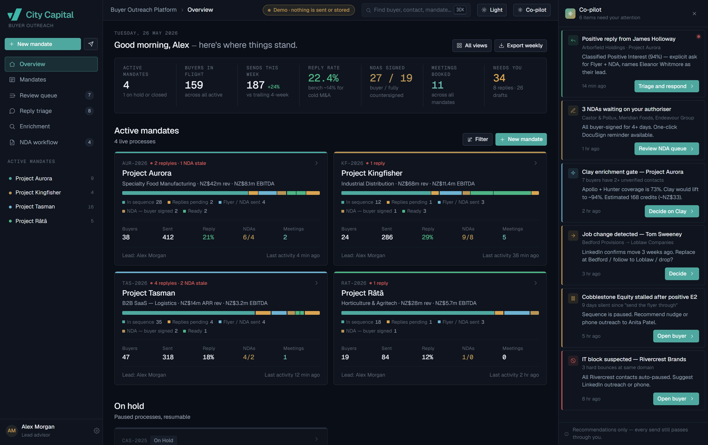
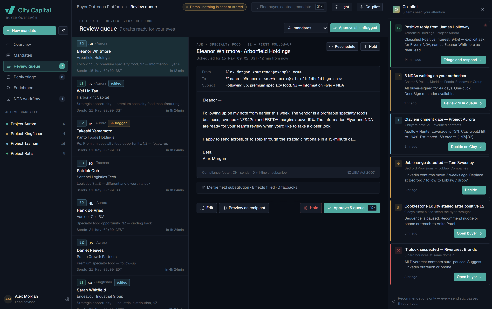
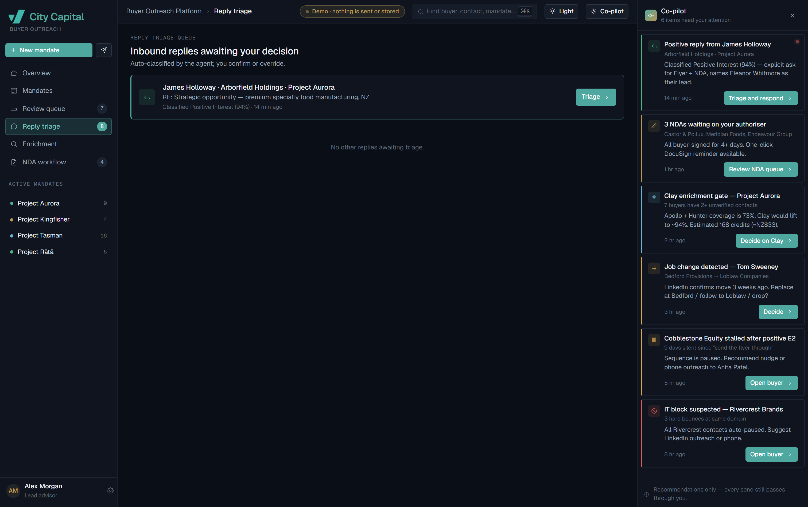
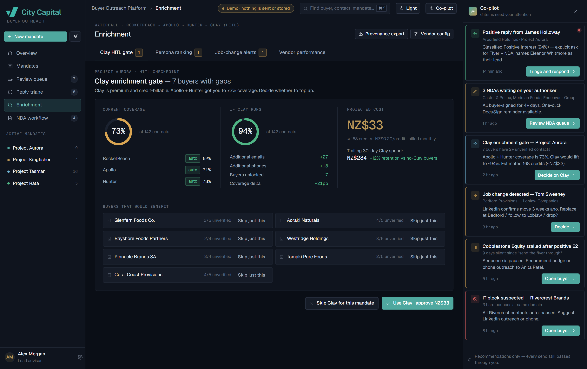
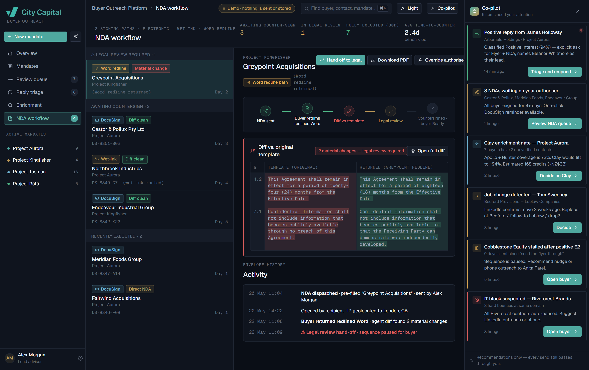
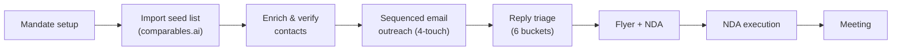
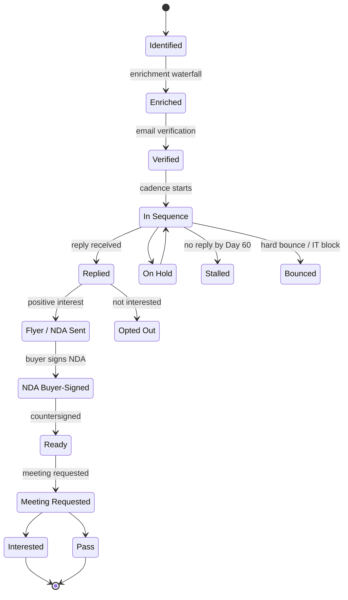
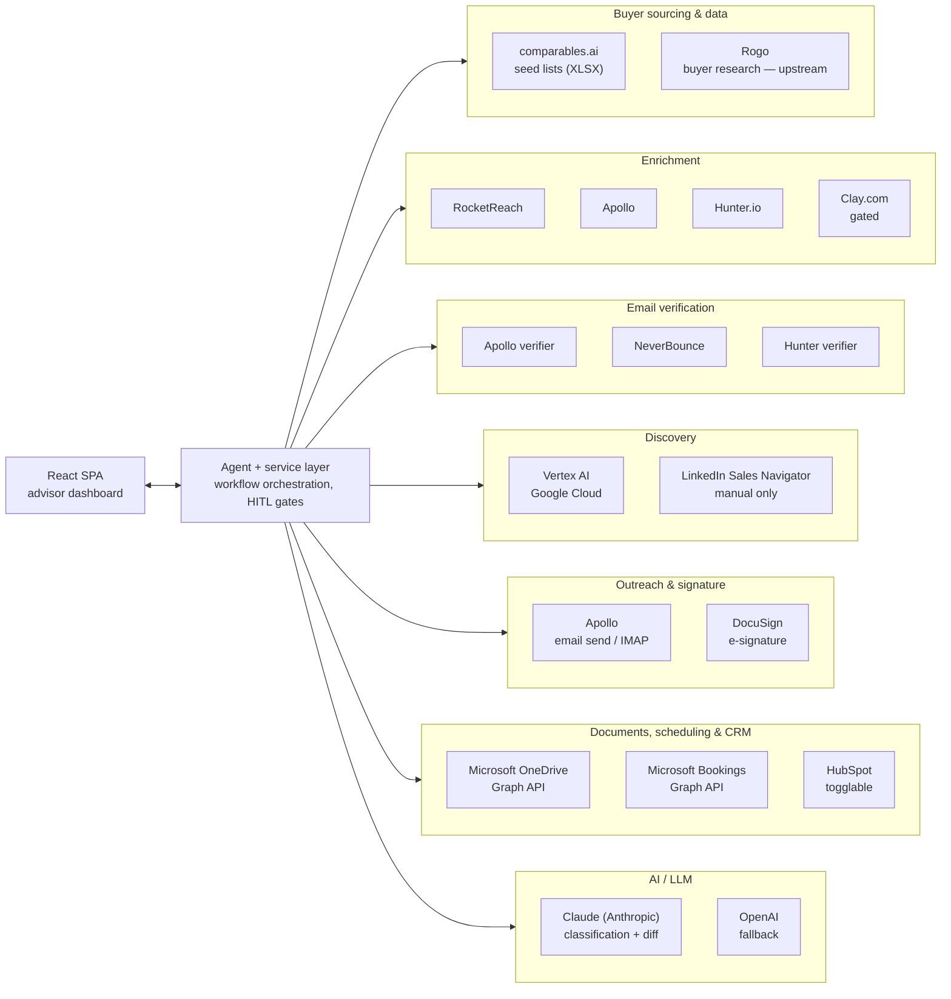
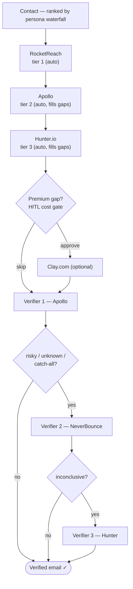
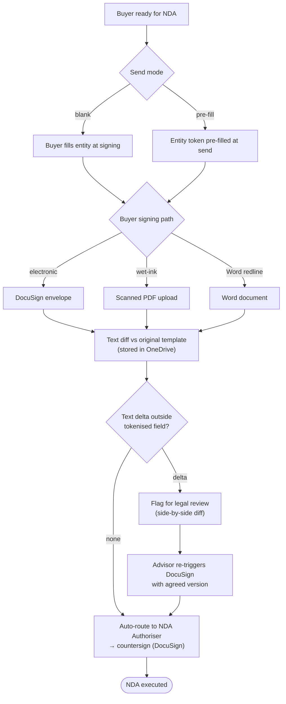

# Buyer Outreach Platform

A **reusable, multi-mandate strategic buyer-outreach platform** for sell-side M&A
processes. It automates the enrichment, sequenced email outreach, NDA execution,
and pipeline tracking of strategic and financial buyers — while the advisor
retains full control through **Human-in-the-Loop (HITL)** checkpoints at every
email send and every client-facing decision.

> **This repository is a no-build, client-side React prototype of the platform's
> UI.** All data is **mock** — there is no backend, no API, and no persistence.
> The sections below describe the full platform as specified (including the
> third-party services it connects to in production); in this prototype those
> integrations are **simulated** with mock data.

The product is designed to be **white-labelled** for advisory teams, so nothing
in the UI is tied to a specific firm.

## Screenshots

Captured from the live prototype at
[buyer-outreach.eqr.vc](https://buyer-outreach.eqr.vc/).

### Overview



The advisor's home: portfolio-level KPIs (active mandates, buyers in sequence,
reply and meeting rates) across the top, a card per active mandate showing its
pipeline funnel and progress, an "on hold" tray, and the AI co-pilot rail on the
right surfacing items that need attention.

### Review queue



The Human-in-the-Loop send gate. Every outbound email is staged here for advisor
approval — the left list shows queued recipients with state and per-contact
flags, while the detail pane renders the fully template-filled message with merge
fields resolved, ready to **Approve & queue**, edit, or hold.

### Reply triage



Inbound replies auto-classified into buckets (e.g. positive interest, not
interested, out-of-office). Any human reply auto-pauses that buyer's cadence and
drops the message here, where the advisor confirms or overrides the suggested
classification before it advances the buyer's state.

### Enrichment



The contact-data view and HITL cost gate. Coverage rings show how much contact
data the automatic vendor waterfall (RocketReach → Apollo → Hunter) has filled,
and the **Clay enrichment gate** quotes the projected cost of optional premium
enrichment so the advisor can approve or skip the spend per mandate.

### NDA workflow



NDA execution and text-diff review. The left rail tracks buyers by signing path
(DocuSign, wet-ink, Word redline); the detail pane shows a side-by-side diff of
the buyer's returned document against the original template, flagging any change
outside the tokenised entity field for legal review before countersignature.

## What it does

A mandate moves through a single, auditable pipeline:



- **Mandate setup** captures only what's needed to execute outreach (sender
  mailbox, signature, sequence template, flyer/NDA documents, NDA authoriser,
  scheduler). Deal strategy, buyer shortlisting, and client sign-off live
  upstream, outside the platform by design.
- **Seed import** ingests advisor-curated Companies + Contacts exports, fuzzy-joins
  them, and applies an exclusion list.
- **Enrichment & verification** run an automatic vendor waterfall with full source
  attribution; conflicting values are retained, never silently merged.
- **Sequenced outreach** sends a templated four-touch cadence with multi-recipient
  staggering (up to 6 contacts per buyer). Outbound content is **fully
  template-driven** — no generative text.
- **Reply triage** classifies inbound replies into six buckets and auto-pauses the
  cadence on any human reply.
- **NDA execution** supports three signing paths, all converging on a text-diff
  check against the original template.
- **Meeting** scheduling is embedded once a buyer is Ready.

### Buyer lifecycle

Each buyer advances through a state machine (defined as `STATES` in `data.js`),
with side states for buyers that pause, decline, stall, or bounce:



## Third-party integrations

In production the platform orchestrates a set of external services, each with a
narrow, well-defined role. The agent calls them but **defers to the advisor at
every outbound send and at gated cost decisions**.



| Platform | Category | Purpose | Auth model |
| --- | --- | --- | --- |
| **comparables.ai** | Sourcing | Source of advisor-curated seed lists (Companies + Contacts XLSX exports) imported into a mandate | File export |
| **Rogo** | Sourcing | Upstream buyer research / shortlisting; automated integration is a future enhancement (out of scope for v1) | — |
| **RocketReach API** | Enrichment | Enrichment tier 1 — runs first, automatically, on every contact | API key |
| **Apollo API** | Enrichment / sending / verification | Enrichment tier 2 (fills gaps), outbound email sending, and email verifier 1 | API key + domain auth |
| **Hunter.io API** | Enrichment / verification | Enrichment tier 3 (fills remaining gaps) and email verifier 3 | API key |
| **Clay.com** | Enrichment | Optional premium enrichment behind a HITL cost-control gate | API key / webhook |
| **NeverBounce API** | Verification | Email verifier 2 — invoked when Apollo returns risky / unknown / catch-all | API key |
| **Vertex AI (Google Cloud)** | Discovery | Grounded web search for LinkedIn URL discovery (fuzzy match) — Vertex AI Search / Google-grounded results | Service account (OAuth 2.0) |
| **LinkedIn Sales Navigator** | Discovery | Manual profile workflow only — no API integration | n/a |
| **DocuSign eSignature REST API** | Signature | NDA envelopes, automated reminders, and two-party countersignature routing | OAuth (JWT grant) |
| **Microsoft OneDrive (Graph API)** | Documents | Mandate-specific source folder for the Flyer PDF, NDA PDF, and NDA Word document; stores the canonical NDA template used for diffing | OAuth (delegated) |
| **Microsoft Bookings (Graph API)** | Scheduling | Meeting scheduler (default option) | OAuth (delegated) |
| **HubSpot API** | CRM / scheduling | CRM activity logging and Meetings scheduler — togglable, off by default | OAuth |
| **Claude (Anthropic)** | AI / LLM | Primary LLM for **deterministic tasks only**: reply classification (6 buckets) and NDA text-diff detection. No generative outbound content | API key |
| **OpenAI (GPT-class)** | AI / LLM | Fallback LLM for resilience if the primary is unavailable | API key |

### Enrichment & verification waterfall

Enrichment vendors run in priority order, each filling gaps left by the previous;
verification then runs in a three-tier waterfall before any send. Conflicting
emails/phones are kept with source attribution (priority RocketReach → Apollo →
Clay → Hunter) and tried in order on send error.



### NDA workflow

Three buyer signing paths converge at a text-diff stage. Any text change versus
the original template — outside the explicitly tokenised entity-fill field —
flags for legal review; a clean diff auto-routes to the mandate's NDA Authoriser
for countersignature.



## Quick start

The `.jsx` files are fetched by Babel via `<script src>`, which most browsers
block over `file://`. Serve the directory over HTTP instead:

```bash
python -m http.server 8000
# then open http://localhost:8000/Buyer%20Outreach%20Platform.html

# or
npx serve .
```

A network connection is required — React, ReactDOM, Babel Standalone, and Google
Fonts are all loaded from CDNs.

## Architecture (prototype)

- **No build step.** React, ReactDOM, and Babel Standalone load from CDNs; `.jsx`
  files are transpiled in the browser at load time. (An optional `npm run build`
  produces a pre-transpiled `dist/` via esbuild for deployment.)
- **Global-namespace module pattern.** There are no ES module imports/exports.
  Each file publishes its components onto `window` via `Object.assign(window, …)`
  (and `data.js` sets `window.VC`). **Load order is the dependency graph** and is
  fixed in `Buyer Outreach Platform.html`.
- **State & routing in `app.jsx`.** `<App/>` owns essentially all application
  state and passes it down via props (no Context/store). A string-based
  pseudo-router (`nav` state) drives which screen renders.
- **Styling.** Inline `style={{}}` objects reference CSS variables defined in
  `theme.css`, which provides design tokens for dark (default) and light themes.

> **Production stack (per spec):** the shipped platform is a Java 21 service built
> on the Embabel agent framework with Spring Boot and a PostgreSQL state store,
> fronted by a React + TypeScript SPA. This prototype reproduces only the
> front-end experience.

### The "hero flow"

The demo is a scripted progression of one buyer — *Arborfield Holdings*
(`b-arborfield`) in the `aurora` mandate — stepped through
`replied → flyer_sent → nda_signed_b → ready → meeting_req → interested_y`. The
floating **Tweaks** panel (bottom-right) exposes demo controls: reset, open the
buyer's triage, and advance one step.

## Project layout

| File / dir | Purpose |
| --- | --- |
| `Buyer Outreach Platform.html` | Entry point; fixes script load order |
| `data.js` | Single read-only mock data store (`window.VC`) |
| `app.jsx` | Root component, app state, pseudo-router |
| `shell.jsx` | `Sidebar`, `Topbar`, `Copilot` right rail |
| `components.jsx` | Shared primitives (`Icon`, `Btn`, `Chip`, `Modal`, …) |
| `overview.jsx`, `mandate.jsx`, `queue.jsx`, `triage.jsx`, `nda.jsx`, `enrichment.jsx` | Screens |
| `buyerDrawer.jsx` | Right-side buyer detail drawer |
| `modals.jsx` | `SetupModal` / `IngestModal` / `DirectNdaModal` |
| `mobile.jsx` | Mobile layout |
| `tweaks-panel.jsx` | Floating dev/editor "Tweaks" panel |
| `theme.css` | Design tokens (dark/light themes) |
| `build.mjs` | Optional esbuild bundler → `dist/` |
| `uploads/` | Reference specification & assets |

See [`CLAUDE.md`](./CLAUDE.md) for deeper architectural notes.
